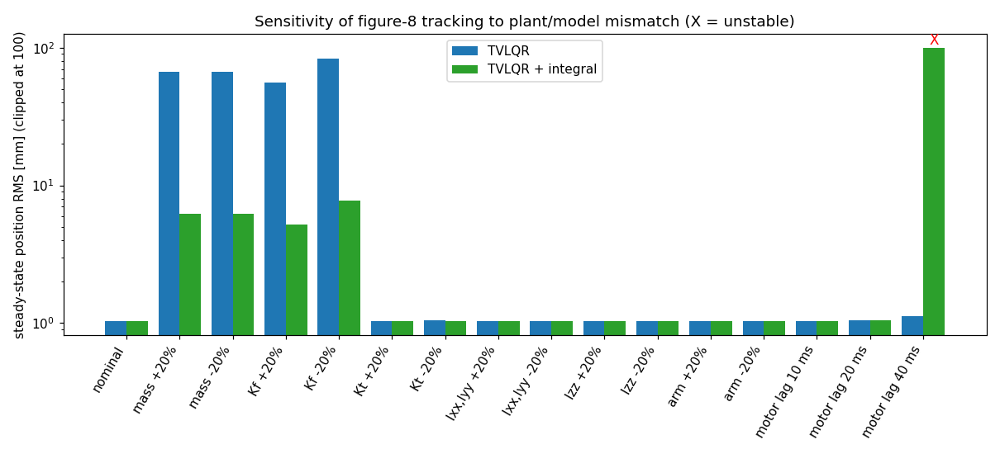
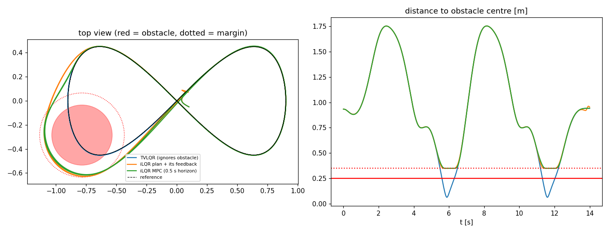

# Crazyflie LQR / TVLQR – review, cleanup and trajectory tracking

This document covers what you asked for, in two rounds.

**Round 1**
1. [Code review](#1-code-review--what-i-found): bugs and weak spots in the Python code and the `animation/` folder.
2. [Reorganisation](#2-new-project-layout): a package with one source of truth for the model, plus real tests.
3. [Trajectory / velocity-profile tracking](#3-trajectory-tracking-with-tvlqr): differential-flatness reference + TVLQR.

**Round 2** (the four "next steps")
1. [Firmware audit and C++ fix](#4-firmware-audit-and-c-fix): which gain is really compiled in, and is it consistent with the loop?
5. [Integral action](#5-integral-action): removes the mass/thrust-error offset.
6. [Parameter identification and sensitivity](#6-parameter-identification-and-sensitivity): tools to re-identify the model, and which parameters matter.
7. [Constrained iLQR and MPC](#7-constrained-ilqr-and-mpc): input bounds, tilt limit, obstacles.

**Round 3**
1. [Semi-implicit Euler integration](#9-semi-implicit-euler-integration): a third integrator, with matching Jacobians, and an honest comparison.

Everything here was **run in simulation** (62 unit tests pass, ~1 min). Nothing was flown. The C++ was *not* built against the Crazyflie firmware tree; the one piece of new C code I could test standalone (the yaw rotation of the gain) is checked against Python with gcc.

```bash
pip install -r requirements.txt
python -m pytest -q tests                          # 62 tests, ~1 min
python -m examples.hover --yaw 90 --export         # regulation, also writes results/Kinf_speeds.txt
python -m examples.track --traj figure8 --animate  # circle | figure8 | helix | velocity
python -m examples.track --traj figure8 --mass-error 0.1 --integral   # with integral action
python -m examples.audit_firmware                  # what is compiled into the C++ (step 4)
python -m examples.export_firmware --rate 100      # gain consistent with the real loop rate (step 4)
python -m examples.sensitivity                     # parameter sensitivity study (step 6)
python -m examples.constrained --scenario all      # iLQR / MPC demos (step 7, ~2 min)
python -m examples.integrators [--planning]        # euler vs semi-implicit vs RK4 (section 9)
```


---

## 1. Code review – what I found

Each item says how I verified it: **[run]** = reproduced by running your code, **[read]** = from reading only.

### 1.1 Things that are actually wrong

| # | Where | Problem | Evidence / impact | Fix in new code |
|---|---|---|---|---|
| 1 | `SO3.Log` / `SO3.minus_right` | `arccos((tr-1)/2)` is not clipped. Rounding noise gives an argument slightly above 1 and the result is **NaN**. **[run]** | `minus_right(R, R)` returned NaN for **57 of 2000** random rotations. This is exactly the regulation limit (R ≈ R_ref), so the controller can emit NaN right when it converges. Your shipped run did not hit it, but it is a landmine. Your commented-out clipped version suggests you met it before. | `atan2(‖vee(R-Rᵀ)/2‖, (tr-1)/2)`, plus an explicit θ≈π branch. 0 NaN in 5000 trials. |
| 2 | `SO3.Log`, `Exp`, `S3.Exp/Log`, `SO3.qR_quat`, `tolerances.py` | `arccos` near 1 has only ~1e-8 resolution, and angles below 1e-7 are hard-thresholded to zero. **[run]** | `Log(Exp(1e-8 z)) = 0`; `Log(Exp(1e-7 z))` has 1.2 % error; `qR_quat` of a 1e-8 rad rotation returns 0; `Exp(5e-8 z)` is the identity, so **ω below 1e-4 rad/s at dt = 1 ms is silently dropped by the integrator**. The state-error noise floor is ~1e-8 rad. | Taylor series for small angles (no thresholds), Shepperd's method for matrix→quaternion. |
| 3 | `speeds_LQR_crazyflie.py` `__main__`: `Kinf_list[int(yaw_ref // (2π/10))]` | Floor division picks the wrong table entry. **[run]** | For `yaw_ref = π/2` it uses entry 2 (yaw = 72°), not 90°: an 18° mismatch in how position error maps to thrust. Rounding would not fix it either: the table only has 36° resolution. | The table is unnecessary: the hover error dynamics are exactly yaw-invariant once position error is rotated into the yaw frame, so `K(ψ) = K₀ · blkdiag(Rz(ψ)ᵀ, I₉)`. One Riccati solve, exact for any yaw (tested). |
| 4 | same file, `Q[0, 0] = 100000.0` while `Q[1:3, 1:3] = 10000.0` | x is weighted 10× more than y and z. Almost certainly a typo for `Q[0:3, 0:3]`. **[read]** | Breaks the yaw symmetry in #3 and makes the controller stiffer in x than in y. | Weights are built from per-group tolerances (`lqr.bryson_weights`). |
| 5 | same file: `save_Kinf_mat(Kinf, "Kinf_speeds.txt")` | `Kinf` there is the **leftover loop variable** (last yaw entry, 324°), not the gain used in the simulation. **[run]** | I rebuilt the gains for table entries 2, 3 and 9 with the script's own settings; none matches the shipped `Kinf_speeds.txt` (row 0, col 0 is −3717; entries give −4568, −2269, −895). So the file is stale or came from different weights. Check which gain the firmware actually runs. | `examples/hover.py --export` writes the gain it simulated, for the target yaw. |
| 6 | `tvlqr()` (both files) | Uses the **global** `dt` instead of a parameter. **[read]** | In `speeds_…` `dt` exists only inside `if __name__ == "__main__"`, so importing and calling `tvlqr` raises `NameError`. The last gain `Kc_list[Knum-1]` stays zero. | `lqr.tvlqr(A_list, B_list, …)` takes explicit matrices; the last gain is repeated. |
| 7 | `run_quadrotor_track_trajectory` and the commented circle | The feed-forward `uk` is ignored (`u = u_bar - K e`). The reference has **zero velocity, zero ω and hover thrust while the position moves**. **[read]** | That reference is not dynamically feasible, so TVLQR would be fighting the reference the whole time. This is why the commented tracking code could not have worked. | Section 3: references come from differential flatness, with `u = F_ref − K e`. |
| 8 | `testing.py` | `from lie_theory_lib import …` – that package does not exist (old project name), so the script cannot run. It also asserts nothing. **[run]** | With the import fixed, `SO3` and `S3` agree to 8.5e-14, so the Lie code is consistent. | `tests/test_lie.py` etc. with real assertions, including regressions for #1/#2. |
| 9 | C++ `LQR_controller_cpp.cpp` ~line 548 | `float state_error[3];` but `compute_state_error` writes 12 floats and `mat412_vec12_multiply` reads 12. **[read, not compiled]** | Stack buffer overflow / undefined behaviour in the control loop. | **Fixed in round 2**, see [section 4](#4-firmware-audit-and-c-fix). |

### 1.2 Latent / lower severity

* **`S3.Log` is not minimal.** It does not flip `q` when `w < 0`; `Log(-q)` of a 0.5 rad rotation returns 5.78 rad **[run]**. Unused today because the project calls `SO3.Log`, but a trap.
* **`linearize_runge_kutta` returns zero matrices.** A silent trap if anyone calls it.
* **`animation/` and the paths.** `save_animation_files(folder="LQR_controller/animation")` is relative to the *current directory*, but `quadrotor_visualize` resolves `folder` relative to its *own file*. It only works when launched from the parent of the package with `-m`. The folder also stores the same information four times: `positions` = `states[:, :3]`, and `orientations` is derived from the quaternion. That is 7.3 MB of 17-digit CSV; an `.npz` is ~0.9 MB.
* **Visualiser (`visualize_crazyflie.py`).**
  * The docstring documents Left/Right arrows but the code binds Up/Down.
  * `interval = dt * 1000` ms regardless of `states_step`, so the playback speed is whatever matplotlib manages.
  * It uses the private `_offsets3d` attribute.
  * `z_min` is computed but never used.
* **Old visualiser (`visualize_crazyflie_old.py` and `thrusts_…`).** `exit(0)` in a key handler, `cla()` + `plt.pause` per frame, and `l = 0.25` is passed as the arm length, so the drawing is not to scale (the arm is 0.046 m).
* **Duplication.** `thrusts_LQR_crazyflie.py` and `speeds_LQR_crazyflie.py` are ~90 % identical and both mix model, Jacobians, LQR, simulation, export and plotting. The thrusts file also runs everything at import time (no `__main__` guard).
* **Dead code and hygiene.** Unused `Rwb_dot`, `dqwb`, `error_tol`, `u_ref`; large commented blocks; imports in the middle of a file; committed `__pycache__`.
* **Gains from a 10 000-step Riccati loop** (`lqr(..., Knum = tf/dt)`), ×10 yaw entries. It is an approximation to the infinite-horizon gain and takes seconds; `scipy.linalg.solve_discrete_are` takes 2 ms.
* **Inverse crime.** The gains are designed on the explicit-Euler model at dt = 1 ms and the plant is simulated with the same Euler at 1 ms, so there is no model mismatch, ZOH, delay or noise anywhere. The results look better than they will on hardware.

### 1.3 Things I checked and found **correct**

* The analytic Jacobians `A`, `B` (including the SO(3) retraction blocks and the `v̂`, `ω̂`, gravity-coupling terms) match central finite differences to **1e-10**. Your own FD check looked worse (~1e-2) only because it was limited by the noisy `Log` of #2.
* Dynamics, thrust/torque mixing, motor geometry (consistent between model and visualiser) and the `S3`/`SO3` composition formulas.
* The saved run converges (final error 2.5e-5 m, yaw error 3e-5 rad). It saturates hard at the start: for the first 0.126 s `u = [0, 2618, 2618, 2618]` rad/s, 1.4 % of all steps overall. Max tilt is 26.9° and the 2 cm settling time is 2.95 s. That is acceptable, but it shows the old weights (Q ~ 1e4, R = 1e-3) are close to bang-bang for a 1.7 m step.

---

## 2. New project layout

```
crazyflie_lqr/
  params.py        CrazyflieParams (mass, inertia, Kf, Kt, …) + derived: hover thrust, mixer, limits
  lie/so3.py       SO(3): robust Exp/Log, Jacobians, plus/minus
  lie/s3.py        quaternions: compose, Exp/Log (minimal), Shepperd from_matrix, rpy
  state.py         manifold state x=[r,q,v,ω]: plus / minus (same convention as the C++ code)
  dynamics.py      f(x,F), analytic Jacobians, Euler / semi-implicit Euler / RK4 + ZOH, INTEGRATORS / DISCRETIZERS registries, FD checker
  lqr.py           DARE gain, yaw-rotated hover gain, TVLQR (Joseph form), speed-gain conversion
  trajectory.py    flatness → feasible reference; circle / figure-8 / helix / velocity profile
  simulation.py    ZOH closed loop (RK4 plant), controllers, SimResult (.npz / legacy CSV), metrics
  visualize.py     animation (interactive or gif) + static summary plots
  io.py            export a gain as a C array
  firmware.py      parse the gain tables out of the C++ file, closed-loop checks of any gain      (round 2)
  sysid.py         parameter identification from bench data and flight logs                      (round 2)
  ilqr.py          constrained iLQR + receding-horizon MPC, soft state constraints               (round 2)
examples/          hover, track, audit_firmware, export_firmware, sensitivity, constrained, integrators
tests/             62 tests (Lie, Jacobians, integrators, LQR, feasibility, tracking, integral, firmware, sysid, iLQR)
firmware/          LQR_controller_cpp.cpp (PATCHED), LQR_controller_cpp.orig.cpp (your original),
                   fix_state_error_and_yaw.patch, test_gain_rotation.c, Kinf_generated.txt (new gain),
                   your Kinf_speeds.txt / Kinf_thrusts.txt (untouched)
docs/              figures used in this README
```

| old | new |
|---|---|
| `SO3_rotation.py`, `S3_rotation.py` | `lie/so3.py`, `lie/s3.py` (same API names, bugs fixed) |
| `tolerances.py` | gone (no thresholds needed) |
| `speeds_…py` + `thrusts_…py` | `params`, `state`, `dynamics`, `lqr`, `simulation`, `examples/hover.py` |
| `visualize_crazyflie.py` | `visualize.py` (reads a `SimResult`, can overlay the reference, can save a gif) |
| `visualize_crazyflie_old.py` | dropped |
| `testing.py` | `tests/` |
| `animation/*.csv` | `results/*.npz`; `SimResult.export_legacy_csv()` writes the old five files |

**One modelling change:** the model is now written in **motor thrusts** `F_i = Kf·u_i²` (your `thrusts_` version) instead of rotor speeds. B is then constant, the R weight is physical (N), and the speed command is `u = sqrt(F/Kf)`. For the firmware, which takes speeds, `lqr.thrust_gain_to_speed_gain` converts the hover gain exactly: `K_u = K_F / (2·Kf·u_hover)`.

**Yaw and firmware:** since `K` depends on the target yaw only through its first three columns, the firmware can rotate them at runtime, `K[:, 0:3] = K₀[:, 0:3] · Rz(ψ)ᵀ`, instead of switching between stored gains.

### Regulation: old vs new (1 m diagonal step + 90° yaw, from rest)

| | old (shipped run) | new `examples.hover` |
|---|---|---|
| settle to 2 cm | 2.95 s | 2.78 s |
| max tilt | 26.9° | 23.6° |
| saturated steps | 1.4 % | 1.6 % |
| max speed | 1.90 m/s | 1.51 m/s |
| final error | 2.5e-5 m | 2.5e-7 |
| gain computation | ~seconds × 10 yaw entries | 2 ms, any yaw |

Plant is RK4 at 1 kHz with the controller at 250 Hz in the new run. A first attempt with Bryson tolerances (position 0.1 m) was **unstable** for the 1.7 m step: tilt exceeded 50° and the vehicle saturated and flipped. Position tolerance 0.3 m / attitude 0.1 rad fixed it. The linear gain cannot handle arbitrarily large steps; for big moves feed a smooth setpoint profile (which is exactly what section 3 gives you). See `docs/hover.png`.

---

## 3. Trajectory tracking with TVLQR

**Why TVLQR and not iLQR.** The vehicle is differentially flat, so a dynamically feasible nominal trajectory (state *and* inputs) can be computed in closed form from a smooth position/yaw profile. iLQR would then converge in one iteration anyway; it only pays off with constraints or non-flat models. TVLQR around the flat reference gives optimal feedback with a trivial backward pass.

**Pipeline** (`trajectory.py`, `lqr.py`, `simulation.py`)

1. *Reference* `r(t), ψ(t)` → `a = r̈`; thrust direction `z_b = (a + g e_z)/‖·‖`, `T = m‖a + g e_z‖`; `R_wb` from `z_b` and the yaw; `ω_b = Log(Rₖ⁻¹Rₖ₊₁)/dt` (manifold differences); `ω̇_b` by differentiation; `τ = Iω̇ + ω×Iω`; nominal motor thrusts `F_ref = M⁻¹[T, τ]`. This gives the full nominal `x_ref(t)`, `F_ref(t)`.
   *Check:* the residual `‖ẋ_ref − f(x_ref, F_ref)‖` is ≤ 2e-4 on all trajectories, and all `F_ref` stay inside [0, F_max] (tested).
2. *Linearise* along the reference with an exact **zero-order-hold** discretisation of the error dynamics (right-perturbation Jacobians, validated against finite differences).
3. *Backward Riccati* (Joseph form) with terminal cost = DARE solution of the last point → gains `K_k` (4×12), ~0.5 s for 3500 steps.
4. *Control:* `F_k = F_ref,k − K_k (x ⊖ x_ref,k)`, saturated to [0, F_max], applied with ZOH at 250 Hz; the plant is RK4 at 1 kHz.

**Trajectories:** `circle`, `figure8` (with z-wobble and yaw following the heading), `helix`, and `velocity`: a **velocity profile** given as world-frame velocity knots (clamped cubic spline, integrated to position). The demo is a stop-and-go square tour. All start and end at rest, with a C² (quintic) speed ramp.

### Results (simulation)

Start offset (0.15, −0.10, 0.10) m from the reference; statistics after the first quarter of the run (transient removed). Tolerances: pos 0.1 m, att 0.2 rad, vel 0.5 m/s, rate 4 rad/s, thrust 0.05 N.

| trajectory | pos RMS | pos max | vel RMS | att RMS | saturation |
|---|---|---|---|---|---|
| circle (r 0.8 m, 0.96 m/s) | 1.11 mm | 1.92 mm | 1.3 mm/s | 0.011° | 0 |
| figure-8 (1.8 m wide, ≈1.4 m/s, ≈13° tilt) | 1.14 mm | 2.83 mm | 1.1 mm/s | 0.127° | 0 |
| helix | 1.05 mm | 1.83 mm | 1.4 mm/s | 0.012° | 0 |
| velocity profile (0.5 m/s square tour) | 0.55 mm | 1.17 mm | 0.4 mm/s | 0.004° | 0 |

Robustness on the figure-8 (`examples.track` flags):

| change | pos RMS |
|---|---|
| nominal | 1.14 mm |
| start error (0.5, 0.5, 0.3) m | 1.14 mm after the transient (0.01 % of steps saturated) |
| measurement noise (2 mm, 0.005 rad, 0.01 m/s, 0.05 rad/s) | 1.37 mm |
| controller at 100 Hz / 50 Hz | 2.7 mm / 5.4 mm |
| **plant mass +10 % / −10 %** | **33.5 mm / 33.4 mm** |


### Honest caveats

* **Model mismatch is the weak point.** Without integral action a 10 % mass (thrust) error leaves a 33 mm steady offset. [Section 5](#5-integral-action) adds integral action and brings it to ~3 mm.
* **"Velocity priority" did not help.** Weighting velocity above position (`--vel-priority`, pos 1 m / vel 0.1 m/s) is *worse* under mass error: 160 mm position error and 24 mm/s velocity error, versus 33 mm and 1.3 mm/s with the default weights. Position feedback is what stiffens the loop. Without model error and without an initial offset, the two weightings give the same result. Keep the default.
* Simulation only: no drag, motor lag, battery sag or estimator. The ZOH/RK4 plant is a deliberate step away from your inverse-crime setup, but it is still the same model structure.
* Running TVLQR on the Crazyflie needs 4×12 floats per control step (≈190 B), so ~2500 steps ≈ 0.5 MB. Probably too much for the STM32 flash; a coarser rate with interpolation, or tracking a handful of precomputed segments, would be needed. I have not looked at the firmware side beyond item #9.
* The reference uses finite differences for `ω̇` (accuracy O(dt²), fine at 4 ms). Analytic jerk/snap would be cleaner for very aggressive trajectories.

## 4. Firmware audit and C++ fix

*(Round-2 step 1.)* Reproduce with `python -m examples.audit_firmware` and `python -m examples.export_firmware`.

### What the firmware really runs

* **The compiled gain is `Kinf_default`.** `Kinf_choice` is initialised to 0 and its `PARAM_ADD` is commented out, so it cannot be switched from the client. The other three tables (`Kinf_alt#1..3`) are only reachable by editing the source.
* **None of the `.txt` files is what is flashed.** `Kinf_speeds.txt` (the one the Python script exported) has very different magnitudes (position-z gain 1573 vs 50-498 in the compiled tables) and is unstable at 100 Hz in the model (table below); `Kinf_thrusts.txt` is in newtons (entries ~0.1), so used as a rotor-speed gain it does essentially nothing.
* **Feed-forward: `hover_adjust = 300 rad/s` is added to the model hover speed.** The hover speed becomes 2197 rad/s instead of 1897 rad/s (the comment still says "approximately 1900"). That is **1.34x the model's hover thrust**: the real vehicle evidently needs a lot more than `m g / 4 = Kf u^2` says. It implies an effective `Kf/m` about 25 % *below* the model, and it shrinks the thrust headroom above hover from 1.9x to 1.4x. Section 6 shows this is exactly the kind of parameter error that matters.
* **The loop is evaluated at `update_rate = RATE_HL_COMMANDER`, which the comments in the file state is 100 Hz** (I could not check the macro itself without the firmware headers). The gains were designed at dt = 1 ms.

### Is the compiled gain consistent with that loop?

Spectral radius of the closed loop in the model (< 1 is stable), ZOH at the given rate:

| table | 1000 Hz | 250 Hz | 200 Hz | 150 Hz | **100 Hz** | 100 Hz, yaw 90° (gain not rotated) |
|---|---|---|---|---|---|---|
| **`Kinf_default` (compiled)** | 0.999 | 0.996 | 0.995 | 1.009 | **2.041** | 2.041 |
| `Kinf_alt#1` / `#2` / `#3` | 0.999 | 0.996–0.998 | 0.995–0.997 | 0.993–0.996 | 0.990 / 0.994 / 0.990 | **1.0015** |
| `Kinf_speeds.txt` | 0.999 | 1.176 | 1.729 | 2.658 | 4.549 | 4.549 |

* **`Kinf_default` is stable at 1 kHz but unstable at 100 Hz in my model.** The unstable mode is the roll/pitch **body-rate loop** (eigenvalue -2.04, pure ω content): by my back-of-envelope estimate its rate gain implies a pole of order -300 /s, which a 10 ms sample-and-hold cannot support (stable down to ~200 Hz, marginal at 150 Hz). In a closed-loop run with the firmware-implied plant it ends in a saturated limit cycle: 50 % of the steps saturated and a 0.11 m error after 6 s for a 0.5 m step, versus clean convergence for the alternatives.
* **Caveat:** this is a model result. If your vehicle flies fine with `Kinf_default`, then either the loop really runs much faster than 100 Hz or the model is missing something that helps; log the real call rate before drawing conclusions.
* **Yaw:** all four tables behave like yaw-0 designs. At a target yaw of 90° with the position columns not rotated, the alternatives become (marginally) unstable (1.0015). The new rotation fixes this.

### What I changed (`firmware/`)

1. `float state_error[3]` -> `[12]` (the overflow).
2. `lqr_rotate_gain_with_yaw()`: rotates the first two position columns of the gain by the setpoint yaw before the multiply (identity at yaw 0, so nothing changes if you only fly yaw 0). The C helper is compiled standalone by `tests/` and matches the Python reference `lqr.rotate_gain_to_yaw` to float precision.
3. `fix_state_error_and_yaw.patch` is the diff; `LQR_controller_cpp.orig.cpp` is your untouched file.
4. **`Kinf_generated.txt`**: a new gain designed *for the loop you actually run*: ZOH at 100 Hz, plant implied by hover speed 2197 rad/s (`hover_adjust` = 300), yaw 0. Spectral radius 0.984. In the 0.5 m diagonal-step test with that plant at 100 Hz: final error 0.1 mm, settling 2.45 s, 11.7° tilt, vs 0.11 m error and 50 % saturation for `Kinf_default`. Paste it into `Kinf_default` (or add it as a new choice) and regenerate it with `--rate` / `--hover-adjust` if either changes.

**Not done / not verified:** I have not built the patched file with the Crazyflie toolchain, and no gain has been flown. Treat `Kinf_generated.txt` as a candidate to try tethered, at low gains first.

---

## 5. Integral action

*(Round-2 step 2.)* `lqr.hover_gain_integral`, `lqr.tvlqr_along_reference_integral`, `simulation.IntegralHoverController`, `simulation.IntegralTVLQRTracker`.

**Design.** The error state is augmented with the integral of the world-frame position error, `xi+ = xi + dt e_pos` (15 states). The augmented system is solved with the same DARE / TVLQR machinery; the integral weight is given as a tolerance on `|integral e| [m s]`. The hover yaw-rotation trick still holds (the integral columns are rotated as well, tested). **Anti-windup:** the integrator is frozen while any motor command is saturated, and clamped.

| (hover, 0.5 m step, plant mass error) | no integral | with integral (tol 0.3) |
|---|---|---|
| 0 % | 0.0 mm | 0.0 mm |
| +10 % | 98.6 mm | 0.0 mm |
| +20 % / -20 % | 197 mm | 0.0 mm |

Settling time rises from 2.6 s (no integral, nominal mass) to 4.4 s with tol 0.3; a stronger integrator (tol 0.1) settles in ~3 s but tilts 33° on the step versus 21° for tol 0.3.

| (figure-8 TVLQR, steady-state position RMS) | nominal | mass +10 % | mass +20 % | mass -20 % |
|---|---|---|---|---|
| no integral | 1.0 mm | 33.3 | 66.7 | 66.6 |
| integral, tol 0.3 | 1.5 | 4.5 | 8.6 | 8.6 |
| integral, tol 0.1 | 1.0 | 3.9 | 7.5 | 7.5 |
| **integral, tol 0.05 (default)** | 1.0 | 3.4 | 6.3 | 6.2 |
| integral, tol 0.03 | 1.0 | 2.6 | 4.9 | 4.9 |
| integral, tol 0.015 | **unstable** | | | |

* **Why not exactly zero on a moving path:** a mass error also corrupts the feed-forward *tilt* along the path, so the disturbance is not constant and an integrator cannot cancel it fully. A thrust-scale estimator would also fix the feed-forward; I did not build one because the integral gets within ~3 mm.
* **Stronger is not better:** tol 0.015 destabilises the loop, so I use 0.05 for tracking (0.3 for hover) as the default.
* **It costs robustness to actuator lag** (section 6): with 40 ms of motor lag the default integral (tol 0.05) is unstable, while the weak one (tol 0.4) is stable. If you add integral action on hardware, start weak.
* The firmware cannot use this as-is: it would need a persistent integrator state and the same anti-windup logic in C.

---

## 6. Parameter identification and sensitivity

*(Round-2 step 3.)* I cannot measure your vehicle, so this step delivers (a) tools that turn your measurements into a parameter file, validated on synthetic data, and (b) a study of which errors actually matter, so you know what to measure first.

### 6.1 What matters (`python -m examples.sensitivity`)

Figure-8 TVLQR, controller on the nominal model, plant perturbed by 20 %, steady-state position RMS:

| plant change | TVLQR | + integral (0.05) |
|---|---|---|
| nominal | 1.0 mm | 1.0 |
| **mass +20 % / -20 %** | **66.7 / 66.6** | 6.3 / 6.2 |
| **Kf +20 % / -20 %** | **55.5 / 83.3** | 5.2 / 7.7 |
| Kt, Ixx/Iyy, Izz, arm length: ±20 % each | 1.0 | 1.0 |
| motor lag 10 / 20 ms | 1.0 / 1.0 | 1.0 / 1.0 |
| motor lag 40 ms | 1.1 | **unstable** |
| motor lag 50 ms and more | **unstable** | unstable |



* **Only the thrust scale (`m` and `Kf`, through `Kf/m`) matters for position tracking.** Inertia, `Kt` and arm length change the motor speeds by up to ~60 rad/s but move the position by only ~0.15 mm; the fast attitude loop absorbs them.
* That ties back to section 4: `hover_adjust = 300 rad/s` is a ~25 % error in exactly this quantity. It is the first thing to identify.
* **Unmodelled motor lag is the real danger.** Without integral action the loop survives 40 ms but not 50 ms; with the default integral it fails at 40 ms. I do not know your motor time constant (use `fit_first_order_lag` below). A lag-aware design (augment the model with the four rotor-speed states) would be the right fix if the measured lag is above ~20 ms; I did not implement it.

### 6.2 Tools (`crazyflie_lqr/sysid.py`)

| measurement | function | gives |
|---|---|---|
| mass on a scale | – | `m` |
| thrust stand: rotor speed vs thrust | `fit_thrust_coefficient` | `Kf` |
| or just the rotor speed that holds hover | `kf_from_hover_speed` | `Kf` (for the measured mass) |
| bifilar pendulum period | `inertia_bifilar` | one moment of inertia per axis |
| tethered hover log with random-binary rotor-speed excitation (gyro, accelerometer, rotor speeds) | `identify_from_log` | `Kf/m`, `l Kf/Ixx`, `l Kf/Iyy`, `Kt/Izz` -> updated `CrazyflieParams` |
| thrust/accel response to a small speed step | `fit_first_order_lag` | motor time constant |

`save_params` / `load_params` write and read a JSON file, so identified values can replace the defaults everywhere (`CrazyflieParams`).

**Validation on synthetic logs** (a "true" vehicle with +4.5 % mass, `Kf` -24 %, inertia +15 %, `Kt` +12 %; gyro noise 0.01 rad/s, accelerometer noise 0.05 m/s^2): `Kf` within 0.1 %, `Ixx`/`Iyy` within 1 %. With 5x more noise `Kf` and the inertias stay within about 1 %. **Limitation:** gyro data identifies only the ratio `Kt/Izz` (the yaw authority, which is what the controller uses), not `Kt` and `Izz` separately; `Kt` therefore inherits the error of the assumed `Izz` (-13 % in that test, where `Izz` was 15 % off). Off-diagonal inertia terms are not identifiable from this excitation and are kept in proportion. Only simulated data has been used: I have no real logs.

---

## 7. Constrained iLQR and MPC

*(Round-2 step 4.)* `crazyflie_lqr/ilqr.py`, `python -m examples.constrained --scenario all`.

**What it is.** iLQR on the same manifold model, with exact ZOH Jacobians and the right-perturbation convention (gradients validated against finite differences). Because the iLQR feedback is `u = U + K dx` (LQR is `u = -K dx`), near hover its `K` equals minus the LQR gain to within 4 % (tested).

* **Input bounds `0 <= F_i <= F_max` are exact**: a projected-Newton box QP in the backward pass; clamped motors get zero feedback (tested for optimality and feasibility).
* **State constraints are soft** (quadratic hinge, Gauss-Newton Hessian): `TiltLimit`, `SphereObstacle`, `FloorLimit`. They are not hard guarantees.
* **`ILQRMPC`**: receding horizon, warm-started from the shifted previous plan.

**Scenario A: large 3-D step** (0, 0, 0.5) -> (1.5, 1, 1.5):

| controller | final error | settle (2 cm) | max tilt | saturated steps |
|---|---|---|---|---|
| LQR hover gain, aggressive (100 Hz) | **diverges** (110 m) | – | 162° | 93 % |
| LQR hover gain, gentle (100 Hz) | 0 | 2.72 s | 30° | 0.5 % |
| iLQR, thrust bounds | 0 | **1.86 s** | 39° | 1.9 % |
| iLQR + tilt <= 30° | 1 mm | 1.87 s | **30°** | 2.4 % |

Planning takes 7-14 s for a 6 s manoeuvre (Python, 20 ms steps, 11-14 iterations). The tilt limit costs essentially no time here.

**Scenario B: figure-8 with a sphere (r = 0.25 m + 0.10 m margin) on the path**, plant mass +5 %:

| controller | min distance to centre | RMS deviation from reference |
|---|---|---|
| TVLQR (ignores obstacle) | 0.065 m (inside) | 26 mm |
| iLQR plan + its feedback | 0.350 m | 95 mm |
| iLQR MPC (0.5 s horizon) | 0.350 m | 101 mm |



The offline plan (35 iterations) takes ~70 s. The MPC re-plans every 0.1 s with 4 iterations: **mean 0.12 s and max 0.45 s per solve in NumPy**, i.e. slightly *slower* than real time. So this is a reference implementation for planning offline or running a ground station with a faster (C++) solver, not something for the STM32.

**Honest limits**
* iLQR is a local method: it needs an initial guess close to a feasible solution and can get stuck behind an obstacle that is dead centre on the path (I offset it by 10 cm to break the symmetry).
* The clearance sits exactly at the margin because the penalty equilibrates there; with a hinge penalty you tune weights and margins, you do not get a guarantee. Hard state constraints would need an augmented-Lagrangian or SQP layer.
* No integral action or lag compensation inside iLQR; the 5 % mass error above is within what the feedback tolerates.
* All planning uses the nominal model and the clean state; no estimator.

---

## 8. What is still open

1. **Fly it, tethered.** Everything above is simulation. Candidates in order: the `Kinf_generated.txt` gain with the patched C++, then integral action.
2. **Log the real loop rate** and the real hover speed; the audit conclusions depend on them (100 Hz and `hover_adjust = 300`).
3. **Measure `m`, `Kf` (or hover speed) and the motor time constant** with the tools in `sysid.py`. These are the parameters that matter.
4. **If the motor lag is above ~20 ms**, add the rotor-speed states to the design (lag-aware LQR/TVLQR).
5. **Porting to the firmware**: integral state and anti-windup in C, optionally a thrust-scale estimator; TVLQR gains do not fit in flash at 4 x 12 floats per step, so keep them off-board or use a few segments.
6. **Hard constraints / real-time MPC** would need an SQP or a compiled solver; the present iLQR is not real-time in Python.

---

## 9. Semi-implicit Euler integration

*(Round 3.)* `dynamics.step_semi_implicit`, `dynamics.discretize_semi_implicit`; select it with `integrator="semi_implicit"` in `simulation.simulate`, `discretization="semi_implicit"` in `lqr.hover_gain` / `tvlqr_along_reference` (and their `_integral` variants), and `Problem(integrator="semi_implicit")` / `ILQRMPC(integrator=...)` in `ilqr`. `dynamics.INTEGRATORS` and `dynamics.DISCRETIZERS` map the names `"euler"`, `"semi_implicit"`, `"rk4"` to the step functions and their discrete Jacobians.

**Definition for this model.** The velocities are the "momenta": they are updated first from the old pose, and the pose is then advanced with the *new* velocities:

```
omega+ = omega + dt * I^-1 (tau - omega x I omega)
v+     = v + dt * ( (R^T [0,0,-m g] + [0,0,T]) / m  -  omega+ x v )     # old R, new omega
q+     = q (x) Exp(omega+ dt)                                           # manifold update, stays unit-norm
r+     = r + dt * R(q+) v+                                              # new orientation, new velocity
```

The discrete Jacobians are **analytic** (chained from the four sub-updates, right perturbations) and agree with central finite differences to ~1e-10 at dt = 1, 10 and 50 ms (tested). That makes the scheme usable everywhere the library needs a discrete model: LQR/DARE design, TVLQR along a reference, the integral-augmented designs, and the iLQR rollouts/backward pass (for sub-stepped planning the Jacobians are chained over the sub-steps).

### What it is and is not good for (`python -m examples.integrators`)

**1. Open-loop accuracy**, 1 s of a lively manoeuvre against RK4 at dt = 0.1 ms (error in position [m] / attitude [rad]):

| integrator | dt = 10 ms | dt = 4 ms | dt = 1 ms | observed order | cost / step |
|---|---|---|---|---|---|
| explicit Euler | 1.8e-1 / 4.6e-2 | 7.3e-2 / 1.9e-2 | 1.8e-2 / 4.6e-3 | 1.01 | 87 µs |
| **semi-implicit Euler** | 3.3e-1 / 5.0e-2 | 1.2e-1 / 2.0e-2 | 3.0e-2 / 5.0e-3 | 1.02 | 92 µs |
| RK4 | 3.0e-4 / 1.2e-4 | 4.9e-5 / 2.0e-5 | 3.0e-6 / 1.2e-6 | 2.00 | 391 µs |

Semi-implicit Euler is **first-order, like explicit Euler, and not more accurate**: in this test its position error is ~1.7x *larger*, its attitude error about the same. In an earlier run of the same test the velocity error was slightly smaller for semi-implicit (0.12 vs 0.13 m/s at 1 ms). RK4 is 3-4 orders of magnitude better at the same step. (RK4's measured order here is 2.0, not 4; I suspect the first-order rotation retraction but did not verify that.) The body-rate equation does not depend on the pose, so semi-implicit and explicit Euler give *identical* `omega`; the two schemes differ only in how `v`, `q`, `r` are advanced, which is why the gains are modest.

**2. Closed loop with the plant integrated at the controller step** (hover gain from the ZOH design; deviation of the position at t = 2 s from the RK4/1 ms run with the same gain):

| controller dt | explicit Euler | **semi-implicit** | RK4 |
|---|---|---|---|
| 10 ms | 1.7e-3 m | **7.3e-4 m** | 9.5e-8 m |
| 20 ms | 3.5e-3 | **1.4e-3** | 4.0e-7 |
| 40 ms | 7.4e-3 | **2.8e-3** | 3.4e-6 |
| 80 ms | 1.7e-2 | **diverged** | 3.0e-5 |

In closed loop it is about 2.5x closer to the truth than explicit Euler at practical rates, but it **diverges at 80 ms** where explicit Euler survives (I did not investigate why; 80 ms is far slower than any realistic loop here). So there is no consistent accuracy advantage over explicit Euler: it is better in one scenario and worse in another.

**3. Design/plant consistency.** Designing the gain on the semi-implicit model and running it on a semi-implicit plant is stable and converges (tested). Designing with `"zoh"`, `"semi_implicit"` or `"euler"` and running on the accurate plant gives closed-loop spectral radii that differ by < 0.001 at 100-200 Hz for both the gentle and an aggressive weighting (0.98 vs 0.98), so the choice of design discretisation barely matters at these rates. Keep `"zoh"`.

**4. Planning cost (iLQR, 3-D step, plan executed on the RK4 plant, my machine):**

| planner integrator | iterations | s / iteration | final error | settle (2 cm) |
|---|---|---|---|---|
| RK4, 2 sub-steps | 14 | 0.88 | 0.6 mm | 1.87 s |
| **semi-implicit, 2 sub-steps** | 15 | **0.54** | 0.9 mm | 1.88 s |
| semi-implicit, 4 sub-steps | 19 | 0.96 | 0.0 mm | 1.86 s |
| explicit Euler, 2 sub-steps | 16 | 0.41 | 0.0 mm | 1.93 s |

Planning with semi-implicit steps is ~1.6x cheaper per iteration than RK4 (no matrix exponential in the backward pass) and the resulting plan flies just as well on the accurate plant, because the iLQR feedback absorbs the model error. Explicit Euler is cheaper still and equally good here.

**Recommendation.** Keep **RK4 as the default** for the plant simulation and for anything where accuracy matters. Use semi-implicit Euler when you want a cheap discrete model with exact analytic Jacobians (e.g. iLQR/MPC planning, or a model small enough to port to C), accepting first-order error. Do not expect it to beat explicit Euler on accuracy, and do not use it with steps beyond ~40 ms. If you wanted a *symplectic* benefit (long-horizon energy behaviour), this vehicle has no conservative structure to exploit, since thrust and gravity-coupled velocities dominate, so I would not rely on that property here.
