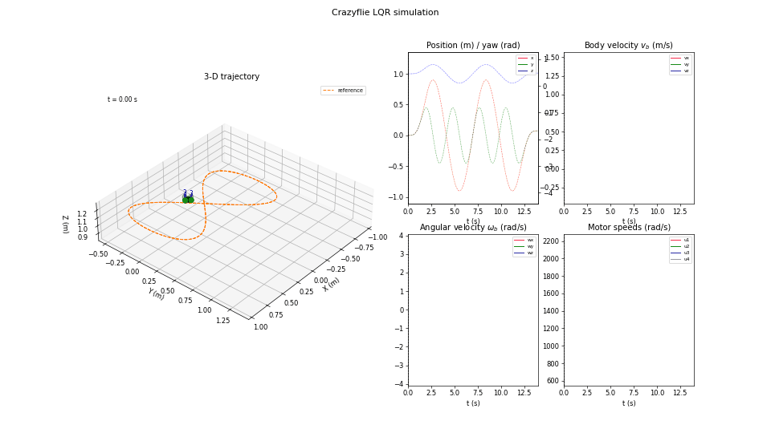
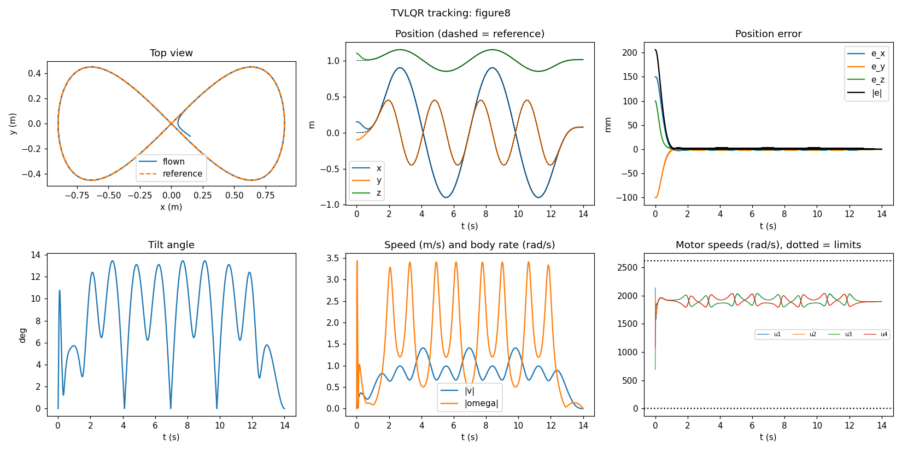

# Crazyflie LQR / TVLQR – review, cleanup and trajectory tracking

This document covers the three things you asked for:

1. [Code review](#1-code-review--what-i-found): bugs and weak spots in the Python code and the `animation/` folder.
2. [Reorganisation](#2-new-project-layout): a package with one source of truth for the model, plus real tests.
3. [Trajectory / velocity-profile tracking](#3-trajectory-tracking-with-tvlqr): differential-flatness reference + TVLQR.

Everything here was **run in simulation** (38 unit tests pass). Nothing was flown, and I did not compile or run the C++ file.

```bash
pip install -r requirements.txt
python -m pytest -q tests                          # 38 tests, ~15 s
python -m examples.hover --yaw 90 --export         # regulation, also writes results/Kinf_speeds.txt
python -m examples.track --traj figure8 --animate  # circle | figure8 | helix | velocity
```



---

## 1. Code review – what I found

Each item says how I verified it: **[run]** = reproduced by running your code, **[read]** = from reading only.

### 1.1 Things that are actually wrong

| # | Where | Problem | Evidence / impact | Fix in new code |
|---|---|---|---|---|
| 1 | `SO3.Log` / `SO3.minus_right` | `arccos((tr-1)/2)` is not clipped. Rounding noise gives an argument slightly above 1 and the result is **NaN**. **[run]** | `minus_right(R, R)` returned NaN for **57 of 2000** random rotations. This is exactly the regulation limit (R ≈ R_ref), so the controller can emit NaN right when it converges. Your shipped run did not hit it, but it is a landmine. Your commented-out clipped version suggests you met it before. | `atan2(‖vee(R-Rᵀ)/2‖, (tr-1)/2)`, plus an explicit θ≈π branch. 0 NaN in 5000 trials. |
| 2 | `SO3.Log`, `Exp`, `S3.Exp/Log`, `SO3.qR_quat`, `tolerances.py` | `arccos` near 1 has only ~1e-8 resolution, and angles below 1e-7 are hard-thresholded to zero. **[run]** | `Log(Exp(1e-8 z)) = 0`; `Log(Exp(1e-7 z))` has 1.2 % error; `qR_quat` of a 1e-8 rad rotation returns 0; `Exp(5e-8 z)` is the identity, so **ω below 1e-4 rad/s at dt = 1 ms is silently dropped by the integrator**. The state-error noise floor is ~1e-8 rad. | Taylor series for small angles (no thresholds), Shepperd's method for matrix→quaternion. |
| 3 | `speeds_LQR_crazyflie.py` `__main__`: `Kinf_list[int(yaw_ref // (2π/10))]` | Floor division picks the wrong table entry. **[run]** | For `yaw_ref = π/2` it uses entry 2 (yaw = 72°), not 90°: an 18° mismatch in how position error maps to thrust. Rounding would not fix it either: the table only has 36° resolution. | The table is unnecessary: the hover error dynamics are exactly yaw-invariant once position error is rotated into the yaw frame, so `K(ψ) = K₀ · blkdiag(Rz(ψ)ᵀ, I₉)`. One Riccati solve, exact for any yaw (tested). |
| 4 | same file, `Q[0, 0] = 100000.0` while `Q[1:3, 1:3] = 10000.0` | x is weighted 10× more than y and z. Almost certainly a typo for `Q[0:3, 0:3]`. **[read]** | Breaks the yaw symmetry in #3 and makes the controller stiffer in x than in y. | Weights are built from per-group tolerances (`lqr.bryson_weights`). |
| 5 | same file: `save_Kinf_mat(Kinf, "Kinf_speeds.txt")` | `Kinf` there is the **leftover loop variable** (last yaw entry, 324°), not the gain used in the simulation. **[run]** | I rebuilt the gains for table entries 2, 3 and 9 with the script's own settings; none matches the shipped `Kinf_speeds.txt` (row 0, col 0 is −3717; entries give −4568, −2269, −895). So the file is stale or came from different weights. Check which gain the firmware actually runs. | `examples/hover.py --export` writes the gain it simulated, for the target yaw. |
| 6 | `tvlqr()` (both files) | Uses the **global** `dt` instead of a parameter. **[read]** | In `speeds_…` `dt` exists only inside `if __name__ == "__main__"`, so importing and calling `tvlqr` raises `NameError`. The last gain `Kc_list[Knum-1]` stays zero. | `lqr.tvlqr(A_list, B_list, …)` takes explicit matrices; the last gain is repeated. |
| 7 | `run_quadrotor_track_trajectory` and the commented circle | The feed-forward `uk` is ignored (`u = u_bar - K e`). The reference has **zero velocity, zero ω and hover thrust while the position moves**. **[read]** | That reference is not dynamically feasible, so TVLQR would be fighting the reference the whole time. This is why the commented tracking code could not have worked. | Section 3: references come from differential flatness, with `u = F_ref − K e`. |
| 8 | `testing.py` | `from lie_theory_lib import …` – that package does not exist (old project name), so the script cannot run. It also asserts nothing. **[run]** | With the import fixed, `SO3` and `S3` agree to 8.5e-14, so the Lie code is consistent. | `tests/test_lie.py` etc. with real assertions, including regressions for #1/#2. |
| 9 | C++ `LQR_controller_cpp.cpp` ~line 548 | `float state_error[3];` but `compute_state_error` writes 12 floats and `mat412_vec12_multiply` reads 12. **[read, not compiled]** | Stack buffer overflow / undefined behaviour in the control loop. You said to ignore non-Python files, but this one is worth a 10-second fix: `float state_error[12];` | – |

### 1.2 Latent / lower severity

* **`S3.Log` is not minimal.** It does not flip `q` when `w < 0`; `Log(-q)` of a 0.5 rad rotation returns 5.78 rad **[run]**. Unused today because the project calls `SO3.Log`, but a trap.
* **`linearize_runge_kutta` returns zero matrices.** A silent trap if anyone calls it.
* **`animation/` and the paths.** `save_animation_files(folder="LQR_controller/animation")` is relative to the *current directory*, but `quadrotor_visualize` resolves `folder` relative to its *own file*. It only works when launched from the parent of the package with `-m`. The folder also stores the same information four times: `positions` = `states[:, :3]`, and `orientations` is derived from the quaternion. That is 7.3 MB of 17-digit CSV; an `.npz` is ~0.9 MB.
* **Visualiser (`visualize_crazyflie.py`).**
  * The docstring documents Left/Right arrows but the code binds Up/Down.
  * `interval = dt * 1000` ms regardless of `states_step`, so the playback speed is whatever matplotlib manages.
  * It uses the private `_offsets3d` attribute.
  * `z_min` is computed but never used.
* **Old visualiser (`visualize_crazyflie_old.py` and `thrusts_…`).** `exit(0)` in a key handler, `cla()` + `plt.pause` per frame, and `l = 0.25` is passed as the arm length, so the drawing is not to scale (the arm is 0.046 m).
* **Duplication.** `thrusts_LQR_crazyflie.py` and `speeds_LQR_crazyflie.py` are ~90 % identical and both mix model, Jacobians, LQR, simulation, export and plotting. The thrusts file also runs everything at import time (no `__main__` guard).
* **Dead code and hygiene.** Unused `Rwb_dot`, `dqwb`, `error_tol`, `u_ref`; large commented blocks; imports in the middle of a file; committed `__pycache__`.
* **Gains from a 10 000-step Riccati loop** (`lqr(..., Knum = tf/dt)`), ×10 yaw entries. It is an approximation to the infinite-horizon gain and takes seconds; `scipy.linalg.solve_discrete_are` takes 2 ms.
* **Inverse crime.** The gains are designed on the explicit-Euler model at dt = 1 ms and the plant is simulated with the same Euler at 1 ms, so there is no model mismatch, ZOH, delay or noise anywhere. The results look better than they will on hardware.

### 1.3 Things I checked and found **correct**

* The analytic Jacobians `A`, `B` (including the SO(3) retraction blocks and the `v̂`, `ω̂`, gravity-coupling terms) match central finite differences to **1e-10**. Your own FD check looked worse (~1e-2) only because it was limited by the noisy `Log` of #2.
* Dynamics, thrust/torque mixing, motor geometry (consistent between model and visualiser) and the `S3`/`SO3` composition formulas.
* The saved run converges (final error 2.5e-5 m, yaw error 3e-5 rad). It saturates hard at the start: for the first 0.126 s `u = [0, 2618, 2618, 2618]` rad/s, 1.4 % of all steps overall. Max tilt is 26.9° and the 2 cm settling time is 2.95 s. That is acceptable, but it shows the old weights (Q ~ 1e4, R = 1e-3) are close to bang-bang for a 1.7 m step.

---

## 2. New project layout

```
crazyflie_lqr/
  params.py        CrazyflieParams (mass, inertia, Kf, Kt, …) + derived: hover thrust, mixer, limits
  lie/so3.py       SO(3): robust Exp/Log, Jacobians, plus/minus
  lie/s3.py        quaternions: compose, Exp/Log (minimal), Shepperd from_matrix, rpy
  state.py         manifold state x=[r,q,v,ω]: plus / minus (same convention as the C++ code)
  dynamics.py      f(x,F), analytic Jacobians, Euler / ZOH discretisation, RK4, FD checker
  lqr.py           DARE gain, yaw-rotated hover gain, TVLQR (Joseph form), speed-gain conversion
  trajectory.py    flatness → feasible reference; circle / figure-8 / helix / velocity profile
  simulation.py    ZOH closed loop (RK4 plant), controllers, SimResult (.npz / legacy CSV), metrics
  visualize.py     animation (interactive or gif) + static summary plots
  io.py            export a gain as a C array
examples/          hover.py, track.py
tests/             38 tests (Lie, Jacobians, LQR, feasibility, tracking)
firmware/          your C++ file and the two Kinf_*.txt, untouched
docs/              figures used in this README
```

| old | new |
|---|---|
| `SO3_rotation.py`, `S3_rotation.py` | `lie/so3.py`, `lie/s3.py` (same API names, bugs fixed) |
| `tolerances.py` | gone (no thresholds needed) |
| `speeds_…py` + `thrusts_…py` | `params`, `state`, `dynamics`, `lqr`, `simulation`, `examples/hover.py` |
| `visualize_crazyflie.py` | `visualize.py` (reads a `SimResult`, can overlay the reference, can save a gif) |
| `visualize_crazyflie_old.py` | dropped |
| `testing.py` | `tests/` |
| `animation/*.csv` | `results/*.npz`; `SimResult.export_legacy_csv()` writes the old five files |

**One modelling change:** the model is now written in **motor thrusts** `F_i = Kf·u_i²` (your `thrusts_` version) instead of rotor speeds. B is then constant, the R weight is physical (N), and the speed command is `u = sqrt(F/Kf)`. For the firmware, which takes speeds, `lqr.thrust_gain_to_speed_gain` converts the hover gain exactly: `K_u = K_F / (2·Kf·u_hover)`.

**Yaw and firmware:** since `K` depends on the target yaw only through its first three columns, the firmware can rotate them at runtime, `K[:, 0:3] = K₀[:, 0:3] · Rz(ψ)ᵀ`, instead of switching between stored gains.

### Regulation: old vs new (1 m diagonal step + 90° yaw, from rest)

| | old (shipped run) | new `examples.hover` |
|---|---|---|
| settle to 2 cm | 2.95 s | 2.78 s |
| max tilt | 26.9° | 23.6° |
| saturated steps | 1.4 % | 1.6 % |
| max speed | 1.90 m/s | 1.51 m/s |
| final error | 2.5e-5 m | 2.5e-7 |
| gain computation | ~seconds × 10 yaw entries | 2 ms, any yaw |

Plant is RK4 at 1 kHz with the controller at 250 Hz in the new run. A first attempt with Bryson tolerances (position 0.1 m) was **unstable** for the 1.7 m step: tilt exceeded 50° and the vehicle saturated and flipped. Position tolerance 0.3 m / attitude 0.1 rad fixed it. The linear gain cannot handle arbitrarily large steps; for big moves feed a smooth setpoint profile (which is exactly what section 3 gives you). See `docs/hover.png`.

---

## 3. Trajectory tracking with TVLQR

**Why TVLQR and not iLQR.** The vehicle is differentially flat, so a dynamically feasible nominal trajectory (state *and* inputs) can be computed in closed form from a smooth position/yaw profile. iLQR would then converge in one iteration anyway; it only pays off with constraints or non-flat models. TVLQR around the flat reference gives optimal feedback with a trivial backward pass.

**Pipeline** (`trajectory.py`, `lqr.py`, `simulation.py`)

1. *Reference* `r(t), ψ(t)` → `a = r̈`; thrust direction `z_b = (a + g e_z)/‖·‖`, `T = m‖a + g e_z‖`; `R_wb` from `z_b` and the yaw; `ω_b = Log(Rₖ⁻¹Rₖ₊₁)/dt` (manifold differences); `ω̇_b` by differentiation; `τ = Iω̇ + ω×Iω`; nominal motor thrusts `F_ref = M⁻¹[T, τ]`. This gives the full nominal `x_ref(t)`, `F_ref(t)`.
   *Check:* the residual `‖ẋ_ref − f(x_ref, F_ref)‖` is ≤ 2e-4 on all trajectories, and all `F_ref` stay inside [0, F_max] (tested).
2. *Linearise* along the reference with an exact **zero-order-hold** discretisation of the error dynamics (right-perturbation Jacobians, validated against finite differences).
3. *Backward Riccati* (Joseph form) with terminal cost = DARE solution of the last point → gains `K_k` (4×12), ~0.5 s for 3500 steps.
4. *Control:* `F_k = F_ref,k − K_k (x ⊖ x_ref,k)`, saturated to [0, F_max], applied with ZOH at 250 Hz; the plant is RK4 at 1 kHz.

**Trajectories:** `circle`, `figure8` (with z-wobble and yaw following the heading), `helix`, and `velocity`: a **velocity profile** given as world-frame velocity knots (clamped cubic spline, integrated to position). The demo is a stop-and-go square tour. All start and end at rest, with a C² (quintic) speed ramp.

### Results (simulation)

Start offset (0.15, −0.10, 0.10) m from the reference; statistics after the first quarter of the run (transient removed). Tolerances: pos 0.1 m, att 0.2 rad, vel 0.5 m/s, rate 4 rad/s, thrust 0.05 N.

| trajectory | pos RMS | pos max | vel RMS | att RMS | saturation |
|---|---|---|---|---|---|
| circle (r 0.8 m, 0.96 m/s) | 1.11 mm | 1.92 mm | 1.3 mm/s | 0.011° | 0 |
| figure-8 (1.8 m wide, ≈1.4 m/s, ≈13° tilt) | 1.14 mm | 2.83 mm | 1.1 mm/s | 0.127° | 0 |
| helix | 1.05 mm | 1.83 mm | 1.4 mm/s | 0.012° | 0 |
| velocity profile (0.5 m/s square tour) | 0.55 mm | 1.17 mm | 0.4 mm/s | 0.004° | 0 |

Robustness on the figure-8 (`examples.track` flags):

| change | pos RMS |
|---|---|
| nominal | 1.14 mm |
| start error (0.5, 0.5, 0.3) m | 1.14 mm after the transient (0.01 % of steps saturated) |
| measurement noise (2 mm, 0.005 rad, 0.01 m/s, 0.05 rad/s) | 1.37 mm |
| controller at 100 Hz / 50 Hz | 2.7 mm / 5.4 mm |
| **plant mass +10 % / −10 %** | **33.5 mm / 33.4 mm** |



### Honest caveats

* **Model mismatch is the weak point.** There is no integral action, so a 10 % mass (thrust) error leaves a 33 mm steady offset. The natural next step is to augment the state with an integrator on position (or estimate a thrust scale). I did not do it.
* **"Velocity priority" did not help.** Weighting velocity above position (`--vel-priority`, pos 1 m / vel 0.1 m/s) is *worse* under mass error: 160 mm position error and 24 mm/s velocity error, versus 33 mm and 1.3 mm/s with the default weights. Position feedback is what stiffens the loop. Without model error and without an initial offset, the two weightings give the same result. Keep the default.
* Simulation only: no drag, motor lag, battery sag or estimator. The ZOH/RK4 plant is a deliberate step away from your inverse-crime setup, but it is still the same model structure.
* Running TVLQR on the Crazyflie needs 4×12 floats per control step (≈190 B), so ~2500 steps ≈ 0.5 MB. Probably too much for the STM32 flash; a coarser rate with interpolation, or tracking a handful of precomputed segments, would be needed. I have not looked at the firmware side beyond item #9.
* The reference uses finite differences for `ω̇` (accuracy O(dt²), fine at 4 ms). Analytic jerk/snap would be cleaner for very aggressive trajectories.

## 4. Suggested next steps

1. Fix the C++ `state_error[3]` overflow and confirm which gain file the firmware really uses (#5).
2. Add integral action (or a thrust-scale estimate) to remove the mass-error offset.
3. Re-identify `m`, `Kf`, inertia; the 33 g mass and `Kf = 2.25e-8` drive everything.
4. If you need constraints (saturation, obstacle corridors), iLQR/MPC on top of the same `dynamics.py` is a small step. The Jacobians and manifold ops are ready.
